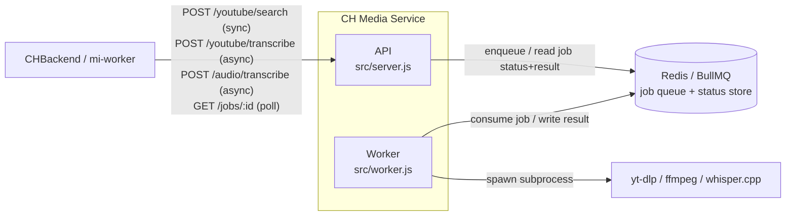
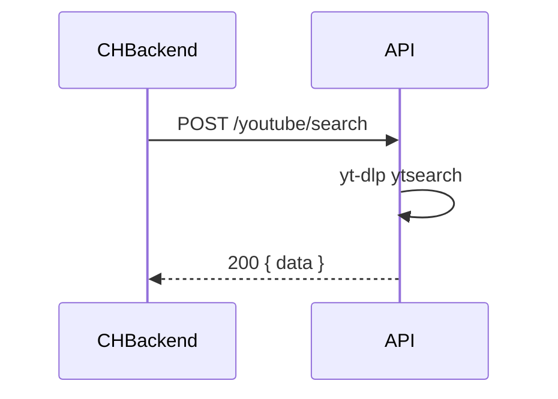
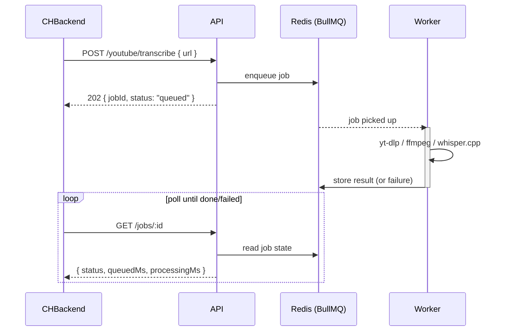

# CH Media Service

Internal HTTP service that owns the **binary-dependent, CPU-heavy media work** for the
Market Intelligence feature — **yt-dlp**, **ffmpeg**, and **whisper.cpp** — so that the
load-balanced `CHBackend` API ships **no media binaries** and does no transcription.

## Why

`CHBackend` runs under PM2 behind a load balancer. Baking yt-dlp/ffmpeg/Whisper into every
API instance (and running transcription on a web tier) is undesirable. This service isolates
all of that: run it as its own image on a single instance (or a GPU box), on a private
network, reachable only by `CHBackend`/`mi-worker`.

## Architecture



The API and worker are separate processes (`ch-media-service.service` /
`ch-media-worker.service`) so a heavy or crashing transcription job never blocks the HTTP
tier that's accepting new requests — the same isolation principle CHBackend already
applies to *this whole service* (see "Why" above), just one layer deeper. Redis is the
only shared state: it's both the job broker and the result/status store BullMQ reads
`GET /jobs/:id` from — there's no separate database.

### Request flow

`/youtube/search` stays synchronous — it's a fast yt-dlp metadata lookup, so the API
handles it directly and returns the result in the same request:



`/youtube/transcribe` and `/audio/transcribe` are async — yt-dlp/ffmpeg/whisper.cpp can
take anywhere from seconds to ~30 minutes (ASR), far too long to hold an HTTP request open:



`/audio/transcribe` follows the same shape, except the multipart upload (and its
validation — file size/extension/ASR-configured checks) happens synchronously on the
initial `POST`, before the job is enqueued; only the ffmpeg-convert + whisper-transcribe
step happens in the worker. See [Endpoints](#endpoints-token-gated) below for the exact
field shapes of each response.

## Endpoints (token-gated)

All requests require `Authorization: Bearer $MEDIA_SERVICE_TOKEN` (unless the token is unset).

The two transcription endpoints are **asynchronous**: they enqueue a job on a
Redis-backed BullMQ queue and respond immediately with `202 { jobId, status: "queued" }`.
The actual yt-dlp/ffmpeg/whisper.cpp work runs in a separate worker process
(`src/worker.js`, run as `ch-media-worker.service`), not in the process that accepted the
HTTP request — poll `GET /jobs/:id` until it reports `done` or `failed`. `/youtube/search`
stays synchronous — it's a fast metadata lookup, not worth a queue round-trip.

- `GET  /health` → `{ status, asrEnabled }`
- `POST /youtube/search` `{ keyword, max? }` → `{ data: [{ url, title }] }` (yt-dlp
  `ytsearch`) — synchronous, not queued.
- `POST /youtube/transcribe` `{ url }` → `202 { jobId, status: "queued" }`
  Job result: `{ url, title, text, language, source, meta }`
  - `source` = `"captions"` or `"asr"`.
  - Prefers yt-dlp captions; whenever there's still no transcript **and** `ASR_ENABLED=true` —
    no subtitles exist, or yt-dlp itself failed on the metadata/caption step (bot-detection,
    geo-block, transient errors, etc.) — it falls back to downloading the audio (16 kHz mono
    WAV via yt-dlp's ffmpeg postprocessor) and transcribing with whisper.cpp.
  - The job fails (`GET /jobs/:id` → `status: "failed"`, `error.statusCode: 422`) only when
    every attempted step failed to produce a transcript; the error message lists which of
    metadata/captions/ASR were attempted and why each one failed.
- `POST /audio/transcribe` — multipart upload, file field `audio` → `202 { jobId, status: "queued" }`
  Job result: `{ text, language }`
  - General-purpose transcription for a directly-uploaded audio file (no YouTube involved).
  - Max size `UPLOAD_MAX_BYTES` (default 50MB) → **413** if exceeded (checked synchronously
    on upload, before anything is queued).
  - Allowed extensions `UPLOAD_ALLOWED_EXTENSIONS` (default `.mp3,.wav,.m4a,.ogg,.webm,.flac`) → **415** if not allowed (also checked synchronously).
  - Converts to 16 kHz mono WAV via ffmpeg, then transcribes with whisper.cpp — no captions fallback, so ASR must be configured (`ASR_ENABLED=true` + `WHISPER_MODEL_PATH`) or the initial request returns **503** before anything is queued.
  - Empty/silent audio is a normal **done** job with `text: ""` (there's no "source" concept to fail here).
- `GET /jobs/:id` → `{ id, status, queuedMs, processingMs, result?, error? }`
  - `status` is one of `queued` | `processing` | `done` | `failed`.
  - `queuedMs` — time spent waiting before a worker picked the job up. Once processing
    has started this is fixed; while still `queued` it keeps growing (measured against
    "now") — a `queued` job with a large, still-climbing `queuedMs` means no worker is
    consuming the queue.
  - `processingMs` — time spent actively processing. `null` until a worker has picked the
    job up; while `processing` it keeps growing (measured against "now") until it
    finishes, then it's fixed.
  - `result` is present when `status: "done"` (shape depends on which endpoint enqueued it,
    as documented above).
  - `error` is present when `status: "failed"`: `{ message, statusCode }`, where
    `statusCode` mirrors what the old synchronous API would have returned (e.g. `422` for
    no usable transcript after exhausting captions + ASR, `500` otherwise).
  - Returns **404** if the job id doesn't exist (never existed, or evicted after
    `JOB_RETENTION_MS`).

A ready-to-import Postman collection + local environment live in [`postman/`](postman/).

## Requirements (host / image)

- Node ≥ 20
- Redis ≥ 6 reachable at `REDIS_URL` — the job queue's broker + result store
- `yt-dlp` on `PATH` (or `YTDLP_PATH`)
- `ffmpeg` on `PATH` (or `FFMPEG_PATH`) — needed for audio extraction + resample
- For ASR: `whisper.cpp` CLI (`WHISPER_CPP_PATH`) + a model file (`WHISPER_MODEL_PATH`),
  then set `ASR_ENABLED=true`
- If yt-dlp starts failing every request with `Sign in to confirm you're not a bot`, YouTube is
  bot-detecting this host's IP — the ASR fallback can't help since it downloads audio via
  yt-dlp too, so the same block applies. Fix it at the source: set `YTDLP_COOKIES` (path to a
  cookies.txt) or `YTDLP_COOKIES_FROM_BROWSER` (browser name yt-dlp can read cookies from on
  this host) so yt-dlp authenticates like a signed-in browser.
- `Requested format is not available` means YouTube handed yt-dlp a degraded or empty format list
  for this client — not that the video is missing captions. Metadata and caption fetching don't
  need a playable format at all, so both pass `--ignore-no-formats-error` and survive it; only the
  ASR audio download genuinely needs one, and it retries across `YTDLP_PLAYER_CLIENT_FALLBACKS`
  (default `tv,web_safari,ios`) before giving up, since which of YouTube's clients get real
  (non-SABR) formats shifts over time. If it still fails everywhere, the host itself is the
  problem: **update yt-dlp first** (`yt-dlp -U`, or re-run `scripts/install-deps.sh`) — a stale
  binary is the single most common cause — then check the JS-runtime and cookie notes below.
- yt-dlp needs a JavaScript runtime to solve YouTube's player challenge; without one it warns
  `some formats may be missing` and falls back to a degraded client. Node is already required by
  this service, so `YTDLP_JS_RUNTIMES` defaults to `node` and is passed automatically **when the
  installed yt-dlp is new enough to understand the flag** (it's probed once via `yt-dlp --help`,
  so an older binary silently keeps the old behaviour instead of erroring on every call). If node
  isn't on the service's `PATH` (common under systemd), set `YTDLP_JS_RUNTIMES=node:/usr/bin/node`.
  Only if your yt-dlp build ships without the bundled EJS scripts do you also need
  `YTDLP_REMOTE_COMPONENTS=ejs:github` — that makes yt-dlp fetch and execute JavaScript from
  GitHub, so it stays opt-in and empty by default.
- Captions are requested for several languages in one yt-dlp run, and YouTube frequently answers
  the 2nd or 3rd language with a 429. That exits yt-dlp non-zero even though earlier languages
  already downloaded, so caption files are read back **regardless of exit status** — one usable
  language is all a transcript needs. A `salvaged <lang> captions ... despite:` log line means
  exactly that happened, and is not an error.

## Run

```bash
cp .env.example .env   # set MEDIA_SERVICE_TOKEN, REDIS_URL (+ whisper paths for ASR)
npm install
npm start              # API — accepts requests, enqueues jobs
npm run worker         # Worker — runs yt-dlp/ffmpeg/whisper.cpp, in a second terminal
```

Both need to be running for jobs to actually complete — the API alone will accept
requests and let you poll `GET /jobs/:id`, but jobs will sit at `status: "queued"` forever
without a worker consuming them.

Point `CHBackend` at it with `MEDIA_SERVICE_URL` + `MEDIA_SERVICE_TOKEN`.

## Deployment (Debian server, behind Caddy + Cloudflare)

This walks through a bare-metal/VM install on Debian: system binaries, the app as a
systemd service, Caddy as the local reverse proxy/TLS terminator, and Cloudflare in
front of it on a custom domain.

### 1. System packages, Node 20 + the media binaries

`scripts/install-deps.sh` installs Node.js (NodeSource), `yt-dlp` (standalone binary),
`ffmpeg`, and — with `--with-asr` — builds `whisper.cpp` and downloads a ggml model.
It's idempotent, so re-running it just skips/upgrades what's already there.

```bash
# copy the repo to the server first (see step 3), then from its root:
chmod +x scripts/install-deps.sh
sudo ./scripts/install-deps.sh                              # Node + yt-dlp + ffmpeg only
sudo ./scripts/install-deps.sh --with-asr                   # + whisper.cpp + base.en model
sudo ./scripts/install-deps.sh --with-asr --model small.en  # pick a different model
```

At the end it prints the resolved paths to drop into `.env`
(`YTDLP_PATH`, `FFMPEG_PATH`, `WHISPER_CPP_PATH`, `WHISPER_MODEL_PATH`).

Run `./scripts/install-deps.sh --help` for all flags, or do it by hand:

<details>
<summary>Manual install (what the script does)</summary>

```bash
sudo apt update
sudo apt install -y curl git build-essential ca-certificates python3

# Node 20.x via NodeSource
curl -fsSL https://deb.nodesource.com/setup_20.x | sudo -E bash -
sudo apt install -y nodejs
node -v   # v20.x

# yt-dlp (Debian's apt package is usually too old — use the standalone binary)
sudo curl -L https://github.com/yt-dlp/yt-dlp/releases/latest/download/yt-dlp -o /usr/local/bin/yt-dlp
sudo chmod a+rx /usr/local/bin/yt-dlp
yt-dlp --version

# ffmpeg (Debian 12/bookworm's package is recent enough)
sudo apt install -y ffmpeg

# whisper.cpp — only needed if ASR_ENABLED=true
sudo apt install -y cmake
git clone https://github.com/ggml-org/whisper.cpp.git /opt/whisper.cpp
cd /opt/whisper.cpp
cmake -B build && cmake --build build -j --config Release
# binary lands at /opt/whisper.cpp/build/bin/whisper-cli

bash ./models/download-ggml-model.sh base.en
# model lands at /opt/whisper.cpp/models/ggml-base.en.bin
```

</details>

### 2. Install Redis (job queue broker)

Debian bookworm's `redis-server` apt package is current enough — no special-casing needed
like `yt-dlp`/`ffmpeg` above:

```bash
sudo apt install -y redis-server
```

Bind it to loopback only and require a password (edit `/etc/redis/redis.conf`):

```
bind 127.0.0.1 -::1
requirepass <run: openssl rand -hex 32>
```

```bash
sudo systemctl restart redis-server
sudo systemctl enable redis-server
redis-cli -a <the password above> ping   # expect PONG
```

This matches the existing loopback-only trust model — Redis is reachable only from
`ch-media-service`/`ch-media-worker` on the same host, never exposed publicly.

### 3. Deploy the app

```bash
sudo useradd --system --create-home --shell /usr/sbin/nologin chmedia
sudo mkdir -p /opt/ch-media-service
sudo chown chmedia:chmedia /opt/ch-media-service

# copy/clone the repo into /opt/ch-media-service, then:
cd /opt/ch-media-service
sudo -u chmedia npm ci --omit=dev
sudo -u chmedia cp .env.example .env
```

Edit `/opt/ch-media-service/.env`:

```bash
PORT=4020
HOST=127.0.0.1                  # loopback only — Caddy is the public entrypoint
MEDIA_SERVICE_TOKEN=$(openssl rand -hex 32)   # generate once, keep it secret

REDIS_URL=redis://:<redis password from step 2>@127.0.0.1:6379

YTDLP_PATH=/usr/local/bin/yt-dlp
FFMPEG_PATH=/usr/bin/ffmpeg
WHISPER_CPP_PATH=/opt/whisper.cpp/build/bin/whisper-cli
WHISPER_MODEL_PATH=/opt/whisper.cpp/models/ggml-base.en.bin
ASR_ENABLED=true
```

### 4. Run it as systemd services

Two units — the API (`ch-media-service`) and the worker (`ch-media-worker`) — run as
separate processes, so a heavy/crashing transcription job in the worker can't take down
the HTTP API that's accepting new requests.

`/etc/systemd/system/ch-media-service.service`:

```ini
[Unit]
Description=CH Media Service (API)
After=network.target redis-server.service

[Service]
Type=simple
User=chmedia
WorkingDirectory=/opt/ch-media-service
EnvironmentFile=/opt/ch-media-service/.env
ExecStart=/usr/bin/node src/server.js
Restart=on-failure
RestartSec=5
NoNewPrivileges=true

[Install]
WantedBy=multi-user.target
```

`/etc/systemd/system/ch-media-worker.service`:

```ini
[Unit]
Description=CH Media Service (worker)
After=network.target redis-server.service

[Service]
Type=simple
User=chmedia
WorkingDirectory=/opt/ch-media-service
EnvironmentFile=/opt/ch-media-service/.env
ExecStart=/usr/bin/node src/worker.js
Restart=on-failure
RestartSec=5
NoNewPrivileges=true

[Install]
WantedBy=multi-user.target
```

```bash
sudo systemctl daemon-reload
sudo systemctl enable --now ch-media-service ch-media-worker
sudo systemctl status ch-media-service ch-media-worker
journalctl -u ch-media-service -u ch-media-worker -f
```

### 5. Reverse proxy with Caddy

```bash
sudo apt install -y debian-keyring debian-archive-keyring apt-transport-https
curl -1sLf 'https://dl.cloudsmith.io/public/caddy/stable/gpg.key' | sudo gpg --dearmor -o /usr/share/keyrings/caddy-stable-archive-keyring.gpg
curl -1sLf 'https://dl.cloudsmith.io/public/caddy/stable/debian.deb.txt' | sudo tee /etc/apt/sources.list.d/caddy-stable.list
sudo apt update
sudo apt install -y caddy
```

`/etc/caddy/Caddyfile`:

```
media.yourdomain.com {
    reverse_proxy 127.0.0.1:4020
}
```

```bash
sudo systemctl reload caddy
```

Caddy auto-provisions/renews the TLS cert for the domain the first time it serves it.

### 6. Cloudflare (custom domain)

- **DNS**: add an `A` record `media` → the server's public IP, proxy status **Proxied**
  (orange cloud).
- **SSL/TLS mode**: set to **Full (strict)** — Cloudflare then validates Caddy's cert
  instead of trusting any self-signed/plaintext origin.
- **Firewall**: only `80`/`443` need to be open publicly (`sudo ufw allow 80,443/tcp`);
  the app itself stays on `127.0.0.1:4020`, unreachable except through Caddy.
- This service was designed to be reachable only from `CHBackend`/`mi-worker` on a
  private network (see "Why" above). Putting it on a public hostname changes that
  trust model — the `MEDIA_SERVICE_TOKEN` bearer check still gates every request, but
  consider also adding a Cloudflare Access application (Zero Trust) or an IP Access
  Rule that allow-lists `CHBackend`'s outbound IP, so the endpoint isn't reachable by
  anyone who just guesses the domain.

### 7. Point CHBackend at it

```bash
MEDIA_SERVICE_URL=https://media.yourdomain.com
MEDIA_SERVICE_TOKEN=<same token as above>
```
